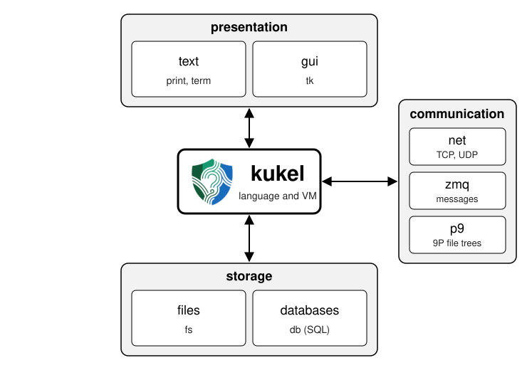

# The Kukel booklet

Kukel is a small programming language with C-like syntax: classes,
closures, generators and exceptions, compiled to bytecode for a small
virtual machine written in Go. This booklet teaches it from the first
program on. Part I is the language; Part II, the modules that come with
it; the appendices, how Go programs and Kukel work together.

Every program in the booklet is run by kukel's tests, and what it prints
is what you see here. The rules in full detail are in the
[reference](../reference.md); this booklet explains them in order.

The language sits in the middle. Around it, modules connect a program to
the world: to people through text and windows (presentation), to files
and databases (storage), and to other programs (communication). Part II
takes them one by one.

## Part I: the language

1. [Getting started](01-getting-started.md): installing, the first
   program, the commands
2. [Values and types](02-values.md): numbers, strings, `nil`, true and
   false; what is equal and what is shared
3. [Strings, vectors and maps](03-collections.md)
4. [Variables and scope](04-scope.md): `local`, `global`, `const`, and
   where a name can be seen
5. [Expressions and operators](05-expressions.md)
6. [Statements](06-statements.md): `if`, the loops, `switch`, labels,
   `with`
7. [Functions](07-functions.md): parameters, defaults, the rest of the
   arguments, recursion
8. [Closures](08-closures.md): functions as values, function literals,
   bound methods
9. [Classes and member functions](09-classes.md): objects, constructors,
   inheritance, static members
10. [Exceptions](10-exceptions.md): `throw`, `try`, `catch`, `finally`,
    and the kinds of errors
11. [Generators](11-generators.md): `yield`, `yield from`, `send`, and
    classes `for` can walk
12. [Your own modules](12-modules.md): splitting a program into files,
    and the module `iter`

## Part II: the modules

*To come:* files and directories (`fs`); text and data (`strings`,
`utf8`, `re`, `json`); time and IDs (`time`, `uuid`); databases (`db`);
events and workers (`events`, `worker`); networking (`net`, `zmq`, `p9`);
the terminal (`term`); the tools (build, fmt, debug, profile, editors);
windows (`tk`).

## Appendices

*To come:* embedding Kukel in Go; Go in Kukel (host modules); code that
is not trusted; keywords, operators, the grammar and compatibility.
